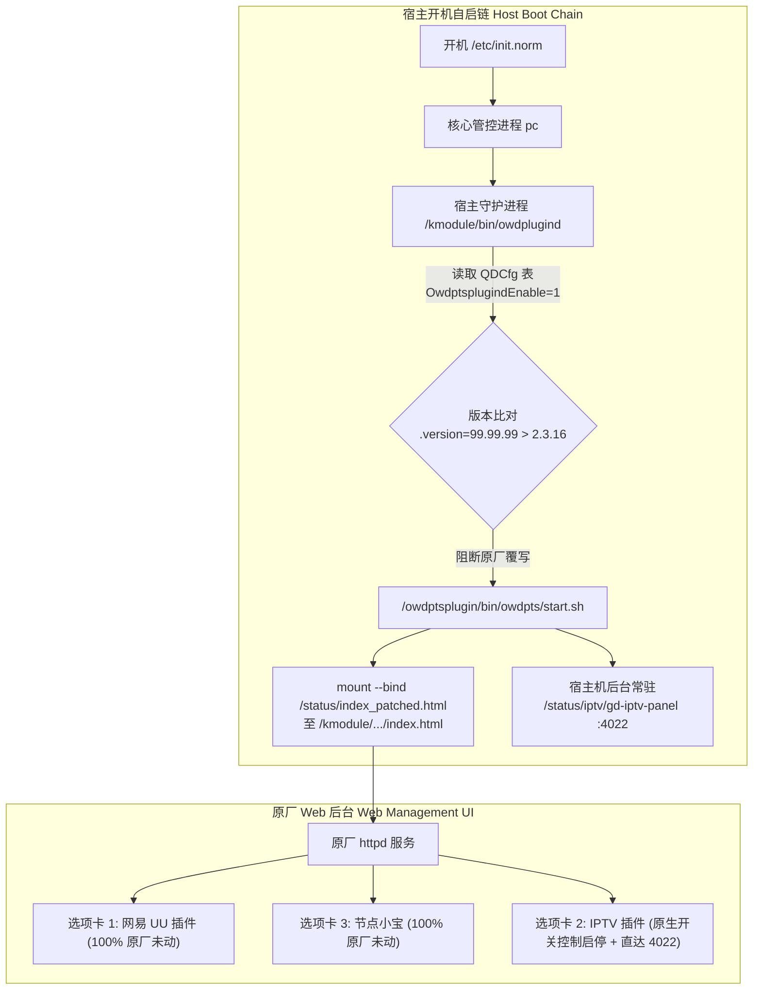

# gd-iptv-panel

广东电信 IPTV 播放列表 + EPG + 内置 RTSP/UDP 代理面板，**专为低资源路由器（OpenWrt / ARM / x86）优化重构**。

- **极致轻量单二进制**：基于 `hyper` 1.x + 单线程 Tokio 运行时，无 `actix-web` / `reqwest` / `rustls` / `xml-rs` / `chrono` / `regex` 等重型依赖。
- **超低资源占用**：静态 musl 二进制体积小、单线程常驻低内存、EPG 流式输出（不整包缓存到内存）、支持 OpenWrt tmpfs 图标缓存不伤闪存。
- **开箱即用**：内置 UDP 组播（`/rtp/`）与 RTSP（`/rtsp/`）代理，支持出站网卡/VLAN 绑定，无需额外部署 `rtp2httpd`。

| 服务 | 地址 |
|---|---|
| 配置面板 | `http://<host>:4022/` |
| 播放列表 | `http://<host>:4022/playlist` |
| EPG (XMLTV) | `http://<host>:4022/xmltv` |

---

## 一、前置条件

- IPTV 账号需已由机顶盒注册并绑定真实 MAC。
- 部署设备（路由器 / 旁路由 / Linux 主机）需能访问 IPTV 专网并接收 IGMP 组播。
- 支持架构：`linux/amd64`、`linux/arm64`、`linux/armv7`（全静态 musl 二进制，无 glibc 依赖）。

---

## 二、安装部署

### 方式 A：一键脚本（自动识别 OpenWrt `procd` 与 `systemd`）

```sh
curl -fsSL https://raw.githubusercontent.com/yfzoyz/gd-iptv/main/install.sh | sh
```

常用管理命令：

```sh
./install.sh upgrade     # 升级（失败自动回滚）
./install.sh restart     # 重启
./install.sh status      # 状态
./install.sh logs        # 实时日志
./install.sh uninstall   # 卸载
```

> 在 OpenWrt 上，脚本会自动生成 `/etc/init.d/gd-iptv-panel`（procd），并将日志指向 `/tmp`（内存盘），避免频繁写入路由器闪存。

---

### 方式 B：ZXSLC SR6211 / 中兴 AX5400 Pro+ 路由器（ARM64 / Linux 4.1.25 / 宿主原生级自动化）

针对中兴 AX5400 Pro+（ZXSLC SR6211），提供纯 Python 零依赖的 Windows **一键自动化部署程序（终极方案：宿主原生守护 · 复用玩辰插件通道）**：

#### 1. 核心架构与底层运行原理

中兴 AX5400 Pro+ 采用中兴自研微内核固件架构（非标准 OpenWrt），无 `procd` 或 `/etc/init.d/`，且根分区 `/dev/root`（MTD8）为只读且 100% 占满（ENOSPC 无法写入）。本项目通过深入逆向固件后台守护链与持久化 Flash 机制，实现了真正的**宿主机 Root 原生自启与无感融合**：



##### 原理解析要点：
1. **彻底规避容器隔离陷阱**：
   原厂「节点小宝」运行在独立 LXC 容器内（独立 Mount Namespace），容器内的挂载对宿主机的 `httpd` 隐形，导致重启后前端 UI 补丁必然回弹。而「玩辰插件」（`owdpts`）的守护进程 `owdplugind`（PID 1894，PPID 825）**直接运行在宿主机的全局根命名空间**中，具备执行全局 `mount --bind` 与宿主网络绑定的最高特权。
2. **版本防覆盖锁（Version Locking）**：
   固件开机时会自动检测 `/owdptsplugin/bin/owdpts/bin/.version` 是否小于 `/etc/owdpts/bin/.version`（2.3.16）。我们将持久化分区内的版本号锁定为 `99.99.99`，原厂开机解包逻辑自动判定为“最新”，**彻底终身杜绝原厂固件解包覆盖自定义脚本**。
3. **安全持久化多 Flash 分区协同**：
   - `/status`（MTD11，5MB JFFS2 rw）：剩余空间 >4MB，存放 548KB 的 `gd-iptv-panel` 二进制、`config.json` 与 `index_patched.html`；
   - `/owdptsplugin/bin`（MTD10，640KB JFFS2 rw）：存放宿主自启与守护脚本；
   - `/tmp` 与 `/var`（tmpfs 内存盘）：日志与 PID 运行时写入，**实现日常运行对 NAND Flash 零写入磨损**。
4. **互不干扰的三权分立**：
   - **网易 UU 插件**：位于 `/UUPlugin/`（MTD9），完全独立，分毫不碰；
   - **IPTV 插件**：接管选项卡 2，由原厂开关原生启停；
   - **节点小宝**：位于 `/jdxb/`（MTD15），100% 恢复官方原厂 `start.sh` 与官方脚本结构，干净无残留。

---

#### 2. 一键极速部署步骤

1. 在电脑端直接双击运行 `一键部署.bat`（或 `python 一键部署.py`）；
2. 脚本将自动连接路由器 Telnet，完成文件下发、MD5 完整性校验、持久化写入与宿主守护链绑定；
3. 部署完成后，路由器管理页面（`http://192.168.1.2`）即刻呈现原生「IPTV插件」选项卡，服务自启并开始监听 `:4022` 端口。

#### 3. 路由器固件重置后的快速恢复

- 第一步：登录路由器后台「系统管理」->「备份与恢复」->「恢复配置」，上传包含 Telnet 激活的配置备份包（`config.bin`），等待 1 分钟重启；
- 第二步：双击运行 `一键部署.bat`，脚本将自动完成全套服务的全自动复原与固化！

---

### 方式 C：独立 Linux / 树莓派等手工运行

```sh
/usr/bin/gd-iptv-panel -c /etc/gd-iptv-panel/config.json
```

### 方式 D：Docker（基于 `scratch` 极简镜像）

```bash
docker run -d \
  --name gd-iptv-panel \
  --network host \
  --restart unless-stopped \
  -v ./data:/data \
  ghcr.io/yfzoyz/gd-iptv-panel:latest
```

---

## 三、首次配置

打开 `http://<路由器IP>:4022/`，默认账号密码均为 `admin`。

1. **面板登录**：建议修改默认密码。
2. **IPTV 账号认证**：填写 `UserID`、密码、机顶盒 `MAC`；路由器多口 / VLAN 环境可在「出站网卡」填写 IPTV 接口名（如 `eth0.41`、`br-iptv`），认证、RTSP 与 IGMP 组播都会绑定到该接口。
3. **内置代理**：
   - 直播勾选 **UDP 组播代理**（走 `/rtp/`）
   - 回看勾选 **RTSP 代理 + 生成时移回看**
   - 按需填写当地 FCC 服务器地址（`IP:端口`）
4. 点击 **保存配置**，可用 **测试 IPTV 连接** 验证认证与频道数量。
5. 将 `http://<路由器IP>:4022/playlist` 导入播放器（TiviMate / VLC / PotPlayer / Kodi），EPG 会通过 `#EXTM3U x-tvg-url` 自动加载。

---

## 四、命令行参数

```text
gd-iptv-panel [选项]

  -c, --config <PATH>      配置文件路径 [默认: $IPTV_CONFIG 或 ./config.json]
  -b, --bind <ADDR>        监听地址（覆盖配置文件）
  -p, --pidfile <PATH>     PID 文件路径（适用于无 systemd 的嵌入式路由器）
      --healthcheck [ADDR] 健康检查（用于 Docker 容器）
  -V, --version            显示版本
  -h, --help               显示帮助
```

---

## 五、API 列表

| 方法 | 路径 | 认证 | 说明 |
|---|---|---|---|
| GET | `/` | ❌ | Web 配置面板（插件关闭时显示停用提示） |
| POST | `/api/login` | ❌ | 登录获取 Token |
| POST | `/api/logout` | ✅ | 注销当前 Token |
| GET | `/api/auth-check` | ❌ | 校验 Token |
| GET | `/api/config` | ✅ | 读取配置 |
| POST | `/api/config` | ✅ | 保存配置 |
| GET | `/api/status` | ✅ | 服务状态与基础统计 |
| POST | `/api/test` | ✅ | 测试 IPTV 认证并返回频道数 |
| GET | `/api/plugin/state` | ❌ | 供路由器原生管理页查询开关状态 |
| POST | `/api/plugin/enable`| ❌ | 供路由器原生管理页提交开启 |
| POST | `/api/plugin/disable`| ❌ | 供路由器原生管理页提交关闭 |
| GET | `/playlist` | ❌ | M3U 播放列表 |
| GET | `/xmltv` | ❌ | 流式 XMLTV EPG |
| GET | `/rtsp/{tail}` | ❌ | RTSP 直播/回看代理 |
| GET | `/rtp/{addr}` | ❌ | UDP 组播代理 |

---

## 六、源码构建

```bash
cargo test
cargo build --release --target x86_64-unknown-linux-musl
```

---

## 七、免责声明

仅供个人学习研究使用，请遵守当地法律法规和运营商服务条款。
